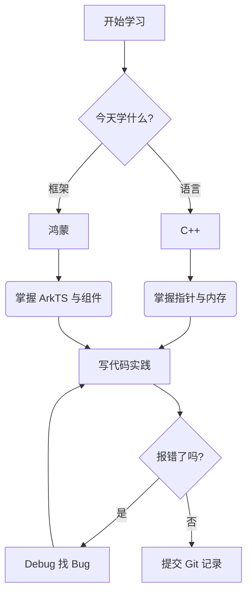

# Markdown 终极语法速查手册

> 本手册涵盖了基础排版、GitHub 扩展语法以及编程笔记常用的高级技巧。

## 目录
- [1. 基础文本与排版](#1-基础文本与排版)
- [2. 列表与任务清单](#2-列表与任务清单)
- [3. 代码与高亮](#3-代码与高亮)
- [4. 链接、图片与引用](#4-链接图片与引用)
- [5. 表格与对齐](#5-表格与对齐)
- [6. GitHub 专属提示框 (Alerts)](#6-github-专属提示框-alerts)
- [7. 高级排版：折叠、脚注与 HTML](#7-高级排版折叠脚注与-html)
- [8. 数学公式 (LaTeX)](#8-数学公式-latex)
- [9. 图表绘制 (Mermaid)](#9-图表绘制-mermaid)
- [10. 转义字符与避坑指南](#10-转义字符与避坑指南)

---

## 1. 基础文本与排版

### 标题
使用 `#` 加空格，最多支持 6 级。
# 一级标题
## 二级标题
### 三级标题

### 字体样式
**加粗**（`**文字**`）
*斜体*（`*文字*`）
***加粗斜体***（`***文字***`）
~~删除线~~（`~~文字~~`）
下划线需要使用 HTML：<u>下划线</u>（`<u>文字</u>`）
高亮文字：==高亮==（部分平台支持，GitHub 不支持）

### 换行与段落
- **段落**：空一行，代表新起一段。
- **换行**：在上一行末尾敲**两个空格**然后回车（或者直接加 `<br>`），代表强制换行。

### 分割线
使用三个以上的 `-` 或 `*`：
---

## 2. 列表与任务清单

### 无序列表与嵌套
使用 `-`、`*` 或 `+` 加空格，缩进两个空格可以嵌套：
- 语言基础
  - C语言
  - C++
- 框架
  - 鸿蒙 (HarmonyOS)
    - ArkTS

### 有序列表
使用数字加点加空格：
1. 第一步
2. 第二步
   1. 子步骤 A
   2. 子步骤 B

### 任务清单 (Task List)
在 GitHub 上可以直接点击打勾：
- [x] 完成 C++ 基础语法学习
- [ ] 掌握鸿蒙组件生命周期
- [ ] 写一篇长文总结

---

## 3. 代码与高亮

### 行内代码
用于标记变量名、函数名：`std::cout`、`@State`。
（语法：`` `代码` ``）

### 代码块
使用三个反引号包围，并在第一行写上语言名称实现高亮：
```cpp
#include <iostream>
int main() {
    std::cout << "Hello C++" << std::endl;
    return 0;
}
```

### 代码块中的行号与高亮（部分平台支持）
```cpp
// 可以在 GitHub 用 diff 语法展示修改
- int a = 10;
+ int a = 20;
```

---

## 4. 链接、图片与引用

### 链接
[点击跳转到我的 GitHub](https://github.com/Rice1002)
（语法：`[显示的文字](链接地址)`）

### 图片

（语法：``，GitHub 支持直接拖拽图片到编辑框）

### 引用
> 这是一个引用块。
> 可以用来摘抄官方文档，或者记录重要笔记。
>
> > 引用块也可以嵌套。

---

## 5. 表格与对齐

使用 `|` 分隔列，`-` 分隔表头与内容。`:` 控制对齐方式。

| 语法 | 难度 | 掌握情况 | 备注 |
| :--- | :---: | :---: | :--- |
| 左对齐 | 低 | 熟练 | 使用 `:---` |
| 居中对齐 | 中 | 熟悉中 | 使用 `:---:` |
| 右对齐 | 高 | 待学习 | 使用 `---:` |

*(表格中如果想换行，可以使用 `<br>` 标签)*
| 功能 | 说明 |
| :--- | :--- |
| 代码换行 | 使用 `<br>` 实现<br>这是第二行 |

---

## 6. GitHub 专属提示框 (Alerts)
*(在 GitHub 的 Issue、PR 或 Markdown 中有效，用于强调重点)*

> [!NOTE]
> 提示：这是一个普通的备注信息。

> [!TIP]
> 技巧：如何更好更快地学习 C++。

> [!IMPORTANT]
> 重要：提交代码前必须检查是否编译通过。

> [!WARNING]
> 警告：这里容易出现内存泄漏。

> [!CAUTION]
> 危险：不要在生产环境直接执行这段代码。

---

## 7. 高级排版：折叠、脚注与 HTML

### 折叠面板 (Details)
非常实用！可以用来隐藏长代码或课后答案。

<details>
<summary>点击展开：C++ 指针核心总结（点击查看）</summary>

1. 指针保存的是内存地址。
2. 使用 `*` 取值，使用 `&` 取地址。
3. 记得用 `delete` 释放用 `new` 申请的内存。

</details>

### 脚注 (Footnotes)
在学习记录中注明参考资料来源非常有用。引用1[^1]，引用2[^2]。

[^1]: 来源：《C++ Primer 中文版》
[^2]: 来源：鸿蒙官方开发者文档

### 常用 HTML 标签
- 键盘按键：<kbd>Ctrl</kbd> + <kbd>C</kbd>
- 居中：<center>这段文字会居中显示</center>
- 换行：<br>
- 上下标（写算法复杂度常用）：H<sub>2</sub>O（`<sub>下标</sub>`），O(n<sup>2</sup>)（`<sup>上标</sup>`）

---

## 8. 数学公式 (LaTeX)
GitHub 原生支持 LaTeX，用来写算法复杂度非常方便。

- 行内公式：`\(O(n \log n)\)`，渲染为 \(O(n \log n)\)。
- 块级公式（使用 `$$` 包围）：
$$
T(n) = 2T\left(\frac{n}{2}\right) + O(n) = O(n \log n)
$$

---

## 9. 图表绘制 (Mermaid)
GitHub 原生支持 Mermaid 语法，可以直接用代码画流程图，对理清代码逻辑和鸿蒙页面路由极有帮助！



---

## 10. 转义字符与避坑指南

- **转义字符**：如果文本中需要显示 `*`、`_`、`#` 等 Markdown 符号，请在符号前加反斜杠 `\`。例如：`\*这不是斜体\*`。
- **空行至关重要**：代码块、表格、列表的上下，**一定要留一个空行**，否则它们可能和正文粘连在一起，导致渲染失败。
- **中英文混排**：建议在中文和英文/数字之间加一个空格（如：学习 C++ 语言），排版看起来会高级很多。